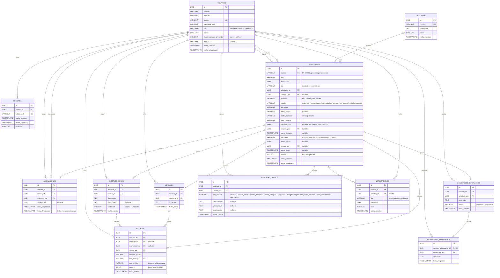

# Modelo entidad-relación — SoporteTI

**Versión:** 1.3  
**Estado:** Modelo de datos revisado; reglas de integridad repartidas entre base de datos y backend  
**Proyecto:** SoporteTI  
**Base de datos:** PostgreSQL (Supabase)

Este modelo desarrolla la sección 6 de `docs/diseno.md` y es coherente con `docs/requisitos.md` y `docs/contrato-api.md`. Si hay diferencias, este documento refleja la decisión más reciente del equipo.

## 1. Diagrama



## 2. Decisiones de modelado

**La solución tiene una sola fuente.** `solicitudes.solucion_final` guarda la solución definitiva, junto con `resuelto_por` y `fecha_resolucion`. Las intervenciones solo registran descripción y diagnóstico. El endpoint `/resolve` escribe estos tres campos y cambia el estado a `resuelto` en una misma transacción.

**Los tiempos de atención se calculan sin analizar texto.** Con `fecha_creacion`, `fecha_resolucion` y `fecha_cierre` se obtienen el tiempo hasta la resolución y el tiempo total del caso (RF-29, CA-06).

**El historial distingue cada tipo de cierre.** `cierre_solucion`, `cierre_administrativo` y `cancelacion` son valores distintos de `tipo_cambio`, como exige `diseno.md` §13.

**El técnico responsable no se duplica.** Se obtiene de la asignación con `fecha_finalizacion IS NULL`.

**Los datos de contacto de la solicitud son una copia intencional.** `medio_contacto` y `dato_contacto` pueden diferir de los de la cuenta del usuario (RF-06).

**El estado de una petición de información se actualiza solo al registrar su respuesta.** Aunque se puede deducir de la existencia de la respuesta, se conserva para consultas y filtros. Lo modifica únicamente la transacción que inserta la respuesta.

**No hay tabla de recuperación de contraseña.** La v1 permite cambiar la contraseña propia y que el coordinador la restablezca; no hay recuperación por correo o SMS.

**Las notificaciones son internas y de una fase posterior.** Solo existen dentro de la plataforma: no hay canal de correo ni estado de envío. La tabla se mantiene en el modelo, pero su implementación no es necesaria para los flujos principales.

**Los datos de contacto son informativos.** `medio_contacto_preferido` y `medio_contacto` indican cómo prefiere el usuario que lo contacte el personal de soporte. El sistema no envía mensajes automáticos por esos medios.

**No se eliminan registros de negocio.** Usuarios y categorías se desactivan (`activo`, `activa`). Todas las claves foráneas usan `ON DELETE RESTRICT`.

## 3. Reglas de integridad

Estas reglas no se ven en el diagrama. Se reparten así:

- **Base de datos (§3.1):** solo las reglas baratas y estables, que protegen la integridad aunque el backend tenga un error. Están en las migraciones `0001_esquema_inicial` y `0002_restricciones_integridad`.
- **Backend (§3.2):** las reglas de negocio y las que pueden cambiar. Se validan en los esquemas Pydantic y en los servicios, con los códigos de error de `contrato-api.md`.

Como RLS está activado en todas las tablas, solo el backend escribe en la base de datos. Por eso las reglas del backend no se pueden saltar desde la API de Supabase.

### 3.1. En la base de datos

| Regla | Mecanismo | Migración |
|---|---|---|
| Una solicitud tiene como máximo una asignación activa | Índice único parcial | 0001 |
| `numero` único y sin colisiones en concurrencia | Secuencia de PostgreSQL | 0001 |
| Una petición de información tiene como máximo una respuesta | `UNIQUE` en `solicitud_informacion_id` | 0001 |
| Un adjunto con mensaje o intervención corresponde a la misma solicitud | Claves foráneas compuestas | 0001 |
| Valores controlados de rol, tipo, prioridad, estado, tipo de cierre, visibilidad y estado de las peticiones de información | `CHECK` | 0002 |
| Un adjunto pertenece a un mensaje o a una intervención, no a ambos | `CHECK` | 0002 |
| El historial no se modifica ni se elimina | Trigger (`UPDATE`, `DELETE` y `TRUNCATE`) | 0002 |

El SQL siguiente corresponde a lo que implementan las migraciones:

```sql
-- Secuencia para el número legible (ST-000001)
CREATE SEQUENCE solicitudes_numero_seq;
ALTER TABLE solicitudes
  ALTER COLUMN numero SET DEFAULT 'ST-' || lpad(nextval('solicitudes_numero_seq')::text, 6, '0');

-- Una sola asignación activa por solicitud
CREATE UNIQUE INDEX uq_asignacion_activa
  ON asignaciones (solicitud_id) WHERE fecha_finalizacion IS NULL;

-- Adjuntos: coherencia con la solicitud del mensaje o de la intervención
ALTER TABLE mensajes
  ADD CONSTRAINT uq_mensajes_solicitud UNIQUE (solicitud_id, id);
ALTER TABLE intervenciones
  ADD CONSTRAINT uq_intervenciones_solicitud UNIQUE (solicitud_id, id);
ALTER TABLE adjuntos
  ADD CONSTRAINT fk_adjuntos_mensaje
    FOREIGN KEY (solicitud_id, mensaje_id) REFERENCES mensajes (solicitud_id, id),
  ADD CONSTRAINT fk_adjuntos_intervencion
    FOREIGN KEY (solicitud_id, intervencion_id) REFERENCES intervenciones (solicitud_id, id);

-- Migración 0002: valores controlados
-- (prioridad y tipo_cierre aceptan NULL; el CHECK no se viola con NULL)
ALTER TABLE usuarios
  ADD CONSTRAINT ck_usuarios_rol CHECK (rol IN ('solicitante', 'tecnico', 'coordinador'));

ALTER TABLE solicitudes
  ADD CONSTRAINT ck_solicitudes_tipo CHECK (tipo IN ('incidente', 'requerimiento')),
  ADD CONSTRAINT ck_solicitudes_prioridad CHECK (prioridad IN ('baja', 'media', 'alta')),
  ADD CONSTRAINT ck_solicitudes_estado CHECK (estado IN (
    'registrado', 'en_evaluacion', 'asignado', 'en_atencion', 'en_espera', 'resuelto', 'cerrado')),
  ADD CONSTRAINT ck_solicitudes_tipo_cierre
    CHECK (tipo_cierre IN ('solucion', 'cancelacion', 'administrativo'));

ALTER TABLE intervenciones
  ADD CONSTRAINT ck_intervenciones_visibilidad CHECK (visibilidad IN ('interna', 'solicitante'));

ALTER TABLE solicitudes_informacion
  ADD CONSTRAINT ck_solicitudes_informacion_estado CHECK (estado IN ('pendiente', 'respondida'));

-- Migración 0002: un adjunto tiene mensaje o intervención, no ambos
-- (con ambos NULL queda ligado solo a la solicitud)
ALTER TABLE adjuntos
  ADD CONSTRAINT ck_adjuntos_un_solo_origen CHECK (num_nonnulls(mensaje_id, intervencion_id) <= 1);

-- Migración 0002: historial inmutable
CREATE FUNCTION fn_historial_inmutable() RETURNS trigger AS $$
BEGIN
  RAISE EXCEPTION 'historial_cambios es inmutable: no se permite %', TG_OP
    USING ERRCODE = 'integrity_constraint_violation';
END;
$$ LANGUAGE plpgsql;
CREATE TRIGGER tg_historial_inmutable
  BEFORE UPDATE OR DELETE ON historial_cambios
  FOR EACH ROW EXECUTE FUNCTION fn_historial_inmutable();
-- TRUNCATE no dispara triggers por fila; se bloquea con uno por sentencia
CREATE TRIGGER tg_historial_inmutable_truncate
  BEFORE TRUNCATE ON historial_cambios
  FOR EACH STATEMENT EXECUTE FUNCTION fn_historial_inmutable();
```

### 3.2. En el backend

Una clave foránea no puede verificar el rol del usuario ni el estado de la solicitud, y algunas reglas cambian con frecuencia. Estas reglas se validan en los esquemas Pydantic y en los servicios, dentro de la misma transacción que la operación:

**Coherencia de los datos de la solicitud**
- Una solicitud cerrada tiene tipo de cierre, responsable (`cerrado_por`) y fecha de cierre; una solicitud no cerrada no tiene ninguno de esos datos ni `motivo_cierre` (RN-35).
- La cancelación y el cierre administrativo exigen `motivo_cierre`; el cierre por solución exige `solucion_final`.
- `solucion_final`, `resuelto_por` y `fecha_resolucion` se registran juntos o no se registra ninguno. El endpoint `/resolve` escribe los tres campos y cambia el estado en una misma transacción.

**Coherencia de los datos de contacto**
- `medio_contacto_preferido` y `medio_contacto` solo aceptan `correo` o `telefono`.
- Si el medio preferido es `telefono`, el campo `telefono` es obligatorio.

**Adjuntos**
- Solo se aceptan archivos `image/png` o `image/jpeg`.
- El tamaño es mayor que 0 y no supera 5 MB (5 242 880 bytes).

**Historial**
- `historial_cambios.tipo_cambio` solo toma los valores definidos en el diagrama (`creacion`, `cambio_estado`, `cambio_prioridad`, `cambio_categoria`, `asignacion`, `reasignacion`, `solucion`, `cierre_solucion`, `cierre_administrativo`, `cancelacion`).

**Reglas de negocio**
- `solicitudes.solicitante_id` corresponde a un usuario con rol `solicitante`.
- `asignaciones.tecnico_id` corresponde a un técnico activo y `asignado_por` a un coordinador.
- `intervenciones.tecnico_id` es el técnico asignado actualmente a la solicitud.
- `respuestas_informacion.respondido_por` es el solicitante propietario de la solicitud.
- `resuelto_por` es el técnico asignado, y `cerrado_por` es un coordinador, salvo en la cancelación, donde es el solicitante.
- Una solicitud en `asignado`, `en_atencion`, `en_espera` o `resuelto` tiene una asignación activa (RN-12).
- Las transiciones de estado siguen la matriz de `requisitos.md` §8.1.
- Una solicitud cerrada no admite nuevos mensajes, intervenciones, adjuntos ni peticiones (RN-22).
- Al desactivar un usuario o restablecer su contraseña se revocan sus sesiones.
- Cada cambio importante inserta su registro en `historial_cambios` dentro de la misma transacción (RN-30).
- La modificación concurrente de una solicitud se controla con `version`; si no coincide, se responde `409 CONFLICTO_CONCURRENCIA`.

## 4. Índices recomendados

| Tabla | Índice | Uso |
|---|---|---|
| `solicitudes` | `(solicitante_id, fecha_creacion DESC)` | Solicitudes propias |
| `solicitudes` | `(estado, prioridad)` | Bandeja y filtros del coordinador |
| `solicitudes` | `(categoria_id)` | Filtros y estadísticas |
| `asignaciones` | `(tecnico_id) WHERE fecha_finalizacion IS NULL` | Solicitudes asignadas al técnico |
| `asignaciones` | `(solicitud_id, fecha_asignacion)` | Historial de asignaciones |
| `mensajes` | `(solicitud_id, fecha_envio)` | Conversación en orden cronológico |
| `solicitudes_informacion` | `(solicitud_id, estado)` | Peticiones pendientes |
| `intervenciones` | `(solicitud_id, fecha_registro)` | Historial de intervenciones |
| `historial_cambios` | `(solicitud_id, fecha_cambio)` | Historial de una solicitud |
| `adjuntos` | `(solicitud_id)` | Adjuntos de una solicitud |
| `sesiones` | `(usuario_id) WHERE revocada = false` | Revocación de sesiones |
| `notificaciones` | `(usuario_id, leida)` | Avisos no leídos |

Las columnas con `UK` ya tienen índice único.

## 5. Cobertura de requisitos

| Criterio | Entidades principales |
|---|---|
| CA-01 Registro de casos | `solicitudes`, `usuarios`, `categorias`, `adjuntos` |
| CA-02 Evaluación y gestión | `solicitudes`, `historial_cambios` |
| CA-03 Responsable y estado | `asignaciones`, `solicitudes` |
| CA-04 Historial de intervenciones | `intervenciones`, `solicitudes_informacion`, `respuestas_informacion`, `mensajes`, `historial_cambios` |
| CA-05 Resultado y cierre | `solicitudes` (`solucion_final`, `tipo_cierre`, `motivo_cierre`, `fecha_cierre`) |
| CA-06 Consolidado | Consultas sobre `solicitudes` y `asignaciones` |