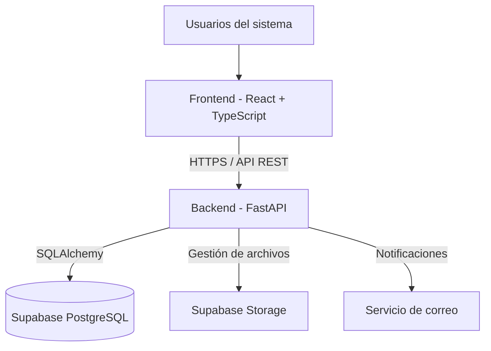
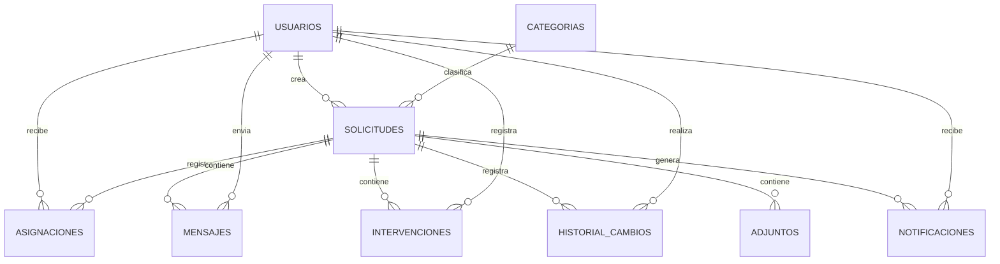

# Diseño de la solución — SoporteTI

**Versión:** 1.3  
**Estado:** Diseño técnico actualizado  
**Proyecto:** SoporteTI  
**Asignatura:** Aplicaciones y Servicios Web

---

## 1. Introducción

Este documento describe el diseño técnico de SoporteTI, una plataforma web para gestionar solicitudes de soporte técnico dentro de una organización.

La plataforma permitirá que los solicitantes registren problemas, consulten el estado de sus solicitudes y mantengan conversaciones con el personal de soporte. Los técnicos podrán atender los casos que les sean asignados, registrar intervenciones y documentar soluciones. Los coordinadores tendrán acceso a la administración general de la plataforma.

El diseño establece la arquitectura, las tecnologías, los componentes, el modelo de datos, los mecanismos de seguridad y la organización del proyecto que orientarán el desarrollo.

## 2. Objetivo del diseño

Definir una arquitectura que permita desarrollar una aplicación web organizada, segura, mantenible y escalable, utilizando tecnologías que faciliten la implementación de los requisitos funcionales y no funcionales establecidos.

Se busca separar las responsabilidades de presentación, lógica de negocio y almacenamiento de información, evitando que las reglas del sistema dependan directamente del frontend.

## 3. Arquitectura general

Se utilizará una arquitectura cliente-servidor organizada en tres capas:

1. **Presentación:** interfaz web utilizada por solicitantes, técnicos y coordinadores.
2. **Lógica de negocio:** backend encargado de procesar solicitudes, validar permisos y ejecutar las reglas del sistema.
3. **Datos:** base de datos y almacenamiento de archivos administrados mediante Supabase.

### 3.1. Componentes principales

- **Frontend:** aplicación web desarrollada con React y TypeScript.
- **Backend:** API desarrollada con Python y FastAPI.
- **Base de datos:** PostgreSQL administrado por Supabase.
- **Almacenamiento:** Supabase Storage para archivos adjuntos y evidencias.
- **Comunicación:** API REST para las operaciones del sistema. Se contempla incorporar WebSockets en una etapa posterior para actualizar conversaciones en tiempo real.
- **Notificaciones:** servicio de correo electrónico para enviar avisos a los usuarios cuando corresponda.

### 3.2. Diagrama de arquitectura



### 3.3. Funcionamiento de la arquitectura

1. El usuario accede a la plataforma desde un navegador.
2. El frontend presenta las funcionalidades correspondientes a su rol.
3. Las operaciones se envían al backend mediante solicitudes HTTP.
4. FastAPI valida la sesión, los permisos y las reglas de negocio.
5. El backend consulta o modifica la información en PostgreSQL.
6. Cuando se requiere almacenar un archivo, el frontend prepara la imagen y FastAPI valida y gestiona su almacenamiento en Supabase Storage.
7. El resultado de cada operación se devuelve al frontend.

El frontend no realizará consultas directas a las tablas de la aplicación ni tendrá acceso a credenciales administrativas de Supabase.

## 4. Tecnologías seleccionadas

| Tecnología | Utilización |
|---|---|
| Python | Lenguaje del backend |
| FastAPI | Desarrollo de la API |
| React | Desarrollo de la interfaz web |
| TypeScript | Tipado estático del frontend |
| Tailwind CSS | Estilos y diseño de la interfaz |
| PostgreSQL | Base de datos relacional |
| Supabase | Administración de PostgreSQL y almacenamiento |
| SQLAlchemy | Mapeo objeto-relacional |
| Alembic | Control de migraciones |
| Pydantic | Validación de datos |
| React Router | Navegación entre páginas |
| Pytest | Pruebas automatizadas del backend |
| Git y GitHub | Control de versiones y colaboración |

Las versiones concretas de las dependencias se establecerán durante la configuración inicial del proyecto.

## 5. Diseño del backend

El backend será responsable de implementar las reglas de negocio y proporcionar los servicios necesarios para el funcionamiento de la plataforma.

Se utilizará FastAPI para exponer los endpoints que consumirá el frontend.

### 5.1. Módulos funcionales

**Autenticación y usuarios**
- Inicio y cierre de sesión.
- Validación de credenciales.
- Administración de cuentas.
- Asignación de roles.
- Activación y desactivación de usuarios.
- Gestión de sesiones y recuperación de acceso.

**Solicitudes**
- Registro de solicitudes.
- Consulta de solicitudes.
- Modificación de información permitida.
- Gestión de estados y prioridades.
- Cancelación y cierre según los permisos establecidos.

**Asignaciones**
- Asignación de solicitudes a técnicos.
- Reasignación de solicitudes.
- Consulta del historial de asignaciones.

**Intervenciones técnicas**
- Registro de actividades realizadas.
- Documentación de diagnósticos.
- Registro de soluciones.
- Clasificación de intervenciones como internas o visibles para el solicitante.

**Conversaciones**
- Envío y consulta de mensajes.
- Asociación de mensajes con una solicitud.
- Comunicación entre solicitantes, técnicos asignados y coordinadores.
- Restricción de nuevos mensajes cuando una solicitud se encuentre cerrada.

**Categorías**
- Creación y modificación de categorías.
- Activación y desactivación de categorías.

**Notificaciones**
- Generación de notificaciones dentro de la plataforma.
- Envío de correos electrónicos según los eventos y preferencias definidos.

**Estadísticas**
- Consulta de solicitudes por estado.
- Consulta de solicitudes por prioridad.
- Estadísticas de atención.
- Indicadores generales para el coordinador.
- Diferenciación entre solicitudes cerradas por solución y por cancelación.

**Historial**
- Registro de cambios relevantes.
- Consulta de modificaciones realizadas.
- Identificación del usuario responsable de cada operación.

### 5.2. Diseño de la API

La API seguirá una estructura REST y utilizará JSON para intercambiar información.

Se utilizará el prefijo `/api/v1` para identificar la primera versión de la API.

| Método | Endpoint | Descripción |
|---|---|---|
| POST | `/api/v1/auth/login` | Iniciar sesión |
| POST | `/api/v1/auth/logout` | Cerrar sesión |
| GET | `/api/v1/auth/me` | Consultar usuario autenticado |
| POST | `/api/v1/auth/recovery` | Solicitar recuperación de acceso |
| GET | `/api/v1/users` | Consultar usuarios |
| POST | `/api/v1/users` | Crear usuarios |
| GET | `/api/v1/users/{id}` | Consultar usuario |
| PATCH | `/api/v1/users/{id}` | Modificar datos permitidos |
| GET | `/api/v1/requests` | Consultar solicitudes autorizadas |
| POST | `/api/v1/requests` | Registrar solicitud |
| GET | `/api/v1/requests/{id}` | Consultar detalle |
| PATCH | `/api/v1/requests/{id}` | Modificar información permitida |
| POST | `/api/v1/requests/{id}/assignments` | Asignar o reasignar técnico |
| POST | `/api/v1/requests/{id}/interventions` | Registrar intervención |
| GET | `/api/v1/requests/{id}/messages` | Consultar conversación |
| POST | `/api/v1/requests/{id}/messages` | Enviar mensaje |
| POST | `/api/v1/requests/{id}/resolve` | Registrar solución |
| POST | `/api/v1/requests/{id}/close` | Cerrar solicitud |
| POST | `/api/v1/requests/{id}/cancel` | Cancelar solicitud |
| GET | `/api/v1/requests/{id}/history` | Consultar historial |
| GET | `/api/v1/categories` | Consultar categorías |
| POST | `/api/v1/categories` | Crear categoría |
| GET | `/api/v1/statistics` | Consultar estadísticas |

Los endpoints definitivos se ajustarán durante la implementación. Las operaciones críticas tendrán validaciones específicas y no dependerán de cambios arbitrarios enviados desde el frontend.

### 5.3. Respuestas y manejo de errores

La API utilizará códigos HTTP adecuados para indicar el resultado de cada operación:

- `200`: operación realizada correctamente.
- `201`: recurso creado.
- `204`: operación completada sin contenido de respuesta.
- `400`: solicitud inválida.
- `401`: usuario no autenticado.
- `403`: usuario sin permisos.
- `404`: recurso no encontrado.
- `409`: conflicto con el estado actual del recurso.
- `422`: datos que no cumplen las validaciones.
- `500`: error interno del servidor.

Las respuestas de error tendrán una estructura consistente y no expondrán información interna ni datos sensibles.

### 5.4. Paginación y filtros

Los listados de solicitudes, mensajes, usuarios e historiales utilizarán paginación para evitar cargar grandes cantidades de información en una sola petición.

Se podrán implementar filtros por:

- Estado.
- Prioridad.
- Categoría.
- Técnico asignado.
- Solicitante.
- Fecha de creación.
- Fecha de cierre.
- Tipo de cierre.

La API deberá validar los parámetros de paginación y limitar la cantidad máxima de registros devueltos.

## 6. Diseño de la base de datos

Se utilizará PostgreSQL mediante Supabase.

La base de datos será relacional y estará organizada para mantener la integridad de la información, evitar duplicidad innecesaria y permitir consultar el historial de atención de cada solicitud.

Se utilizarán identificadores UUID como claves primarias y campos de fecha con zona horaria para conservar correctamente los registros temporales.

### 6.1. Entidades principales

#### 6.1.1. usuarios

Almacena las cuentas de las personas que utilizan la plataforma.

Campos propuestos:

- `id`: UUID, clave primaria.
- `nombre`: nombre del usuario.
- `apellido`: apellido del usuario.
- `correo`: correo electrónico único.
- `password_hash`: hash de la contraseña.
- `rol`: solicitante, técnico o coordinador.
- `activo`: indica si la cuenta está habilitada.
- `fecha_creacion`: fecha de creación.
- `fecha_actualizacion`: última modificación.

Las cuentas serán creadas por el coordinador. No existirá registro público.

#### 6.1.2. categorias

Almacena las categorías disponibles para clasificar las solicitudes.

Campos propuestos:

- `id`: UUID, clave primaria.
- `nombre`: nombre de la categoría.
- `descripcion`: descripción.
- `activa`: indica si puede utilizarse.
- `fecha_creacion`: fecha de creación.

#### 6.1.3. solicitudes

Contiene la información principal de cada solicitud de soporte.

Campos propuestos:

- `id`: UUID, clave primaria.
- `numero`: identificador legible y único de la solicitud.
- `titulo`: título del problema.
- `descripcion`: descripción del problema.
- `solicitante_id`: usuario que registra la solicitud.
- `categoria_id`: categoría asociada.
- `prioridad`: nivel de prioridad.
- `estado`: estado actual.
- `medio_contacto`: medio de contacto seleccionado.
- `tipo_cierre`: solución o cancelación, cuando corresponda.
- `motivo_cierre`: explicación del cierre o cancelación.
- `fecha_creacion`: fecha de registro.
- `fecha_actualizacion`: última modificación.
- `fecha_cierre`: fecha de cierre, cuando corresponda.
- `cerrado_por`: usuario responsable del cierre.
- `solucion_final`: resumen de la solución definitiva, cuando exista.

El técnico responsable se obtendrá de la tabla de asignaciones activas, evitando mantener el mismo dato duplicado en dos tablas.

El campo `tipo_cierre` permitirá diferenciar una solicitud cerrada después de una atención de otra que fue cancelada.

#### 6.1.4. asignaciones

Registra las asignaciones y reasignaciones de técnicos.

Campos propuestos:

- `id`: UUID, clave primaria.
- `solicitud_id`: solicitud asociada.
- `tecnico_id`: técnico asignado.
- `asignado_por`: coordinador que realiza la operación.
- `fecha_asignacion`: fecha de asignación.
- `fecha_finalizacion`: fecha en que termina la asignación.
- `observacion`: motivo o comentario de la asignación.

Una solicitud podrá tener varias asignaciones históricas, pero solamente una asignación activa a la vez.

#### 6.1.5. mensajes

Almacena los mensajes intercambiados durante la atención de una solicitud.

Campos propuestos:

- `id`: UUID, clave primaria.
- `solicitud_id`: solicitud asociada.
- `remitente_id`: usuario que envía el mensaje.
- `contenido`: contenido del mensaje.
- `fecha_envio`: fecha y hora de envío.

Los mensajes pertenecerán a la conversación de la solicitud y podrán ser consultados por el solicitante, el técnico asignado y el coordinador, según sus permisos.

#### 6.1.6. intervenciones

Registra las actividades realizadas por el personal técnico.

Campos propuestos:

- `id`: UUID, clave primaria.
- `solicitud_id`: solicitud asociada.
- `tecnico_id`: técnico que registra la intervención.
- `descripcion`: actividad realizada.
- `diagnostico`: diagnóstico técnico, cuando corresponda.
- `solucion`: solución aplicada, cuando corresponda.
- `tipo`: clasificación de la intervención.
- `visible_solicitante`: indica si el solicitante puede consultarla.
- `fecha_registro`: fecha y hora del registro.

Las intervenciones se mantendrán separadas de los mensajes de conversación.

#### 6.1.7. historial_cambios

Registra las modificaciones relevantes realizadas sobre las solicitudes.

Campos propuestos:

- `id`: UUID, clave primaria.
- `solicitud_id`: solicitud afectada.
- `usuario_id`: usuario que realiza el cambio.
- `tipo_cambio`: tipo de modificación.
- `valor_anterior`: valor previo, cuando corresponda.
- `valor_nuevo`: nuevo valor, cuando corresponda.
- `observacion`: descripción adicional.
- `fecha_cambio`: fecha y hora del cambio.

Se utilizará para registrar cambios de estado, prioridad, categoría, asignaciones, cierres y cancelaciones.

La tabla de asignaciones conservará el detalle de cada asignación; el historial general permitirá consultar los cambios como parte de la evolución de la solicitud.

#### 6.1.8. adjuntos

Almacena los metadatos de los archivos relacionados con solicitudes, mensajes o intervenciones.

Campos propuestos:

- `id`: UUID, clave primaria.
- `solicitud_id`: solicitud asociada.
- `mensaje_id`: mensaje asociado, si corresponde.
- `intervencion_id`: intervención asociada, si corresponde.
- `nombre_archivo`: nombre original del archivo.
- `ruta_storage`: ubicación del archivo en Supabase Storage.
- `tipo_archivo`: formato del archivo almacenado.
- `tamano`: tamaño del archivo almacenado en bytes.
- `fecha_subida`: fecha y hora de subida.

Cada adjunto deberá estar asociado a una solicitud y, opcionalmente, a un mensaje o intervención. Se establecerán restricciones para evitar asociaciones ambiguas.

El archivo físico se almacenará en Supabase Storage. PostgreSQL conservará únicamente sus metadatos y su ruta, no el contenido binario.

Las imágenes originales podrán recibirse en PNG o JPG, pero se convertirán a WebP antes de su almacenamiento. Por tanto, `tipo_archivo` y `tamano` representarán el archivo final almacenado.

#### 6.1.9. notificaciones

Registra las notificaciones generadas para los usuarios.

Campos propuestos:

- `id`: UUID, clave primaria.
- `usuario_id`: usuario destinatario.
- `solicitud_id`: solicitud relacionada, cuando corresponda.
- `tipo`: tipo de notificación.
- `contenido`: descripción del aviso.
- `canal`: plataforma o correo.
- `estado_envio`: estado del envío.
- `leida`: indica si el usuario la ha leído en la plataforma.
- `fecha_creacion`: fecha de creación.
- `fecha_envio`: fecha de envío, cuando corresponda.

### 6.2. Relaciones principales

- Un usuario solicitante puede registrar múltiples solicitudes.
- Una categoría puede estar asociada a múltiples solicitudes.
- Una solicitud puede tener diferentes asignaciones a lo largo del tiempo.
- Un técnico puede tener múltiples asignaciones.
- Una solicitud puede tener múltiples mensajes.
- Un usuario puede enviar múltiples mensajes.
- Una solicitud puede tener múltiples intervenciones.
- Un técnico puede registrar múltiples intervenciones.
- Una solicitud puede tener múltiples registros de historial.
- Una solicitud puede tener múltiples archivos adjuntos.
- Un usuario puede recibir múltiples notificaciones.

### 6.3. Diagrama entidad-relación preliminar



Este modelo es preliminar. Durante la implementación se definirán los tipos de datos, restricciones, índices, claves foráneas y reglas de integridad.

### 6.4. Restricciones de integridad

Se establecerán restricciones para garantizar la consistencia de la información:

- El correo electrónico de cada usuario será único.
- Los roles estarán limitados a solicitante, técnico y coordinador.
- Los estados, prioridades y tipos de cierre utilizarán valores controlados.
- Las solicitudes deberán tener un solicitante válido.
- Las asignaciones solo podrán asociar técnicos activos.
- Una solicitud no podrá tener más de una asignación activa.
- Los mensajes deberán pertenecer a una solicitud existente.
- Las intervenciones deberán estar asociadas a una solicitud existente.
- Los archivos adjuntos deberán tener una asociación válida.
- Los registros históricos no se modificarán desde las operaciones normales de la aplicación.
- Las solicitudes cerradas no admitirán nuevas operaciones de atención.
- Una solicitud con estado `Cerrado` deberá tener un tipo de cierre y una fecha de cierre.
- El tipo de cierre deberá distinguir entre solución y cancelación.

Las reglas que involucren varias tablas se validarán mediante transacciones y lógica de negocio en el backend, utilizando restricciones adicionales cuando sea posible.

## 7. Diseño de los estados y transiciones

Los estados representan el ciclo de vida de una solicitud.

Se contemplan los siguientes estados:

| Estado | Descripción |
|---|---|
| Registrado | Solicitud recién creada |
| En evaluación | Solicitud pendiente de revisión y clasificación |
| Asignado | Solicitud asignada a un técnico |
| En atención | El técnico está trabajando en el caso |
| En espera | La atención está pendiente de información u otra condición |
| Resuelto | El técnico ha registrado una solución para revisión |
| Cerrado | Solicitud finalizada o cancelada |

La cancelación no será un estado independiente. Se representará mediante el estado `Cerrado` y el tipo de cierre `Cancelación`.

### 7.1. Reglas de transición

- Una solicitud nueva inicia en `Registrado`.
- El coordinador puede pasarla a `En evaluación`.
- El coordinador puede asignarla a un técnico.
- El técnico asignado puede avanzar la atención y solicitar información.
- El técnico asignado puede registrar una solución y dejar la solicitud en `Resuelto`.
- El coordinador revisa la solución y puede cerrar la solicitud.
- Si la solución no es satisfactoria, el coordinador puede devolverla a atención.
- El solicitante puede cancelar la solicitud únicamente en los estados permitidos por los requisitos.
- Cuando el solicitante cancela, el estado pasa a `Cerrado` y el tipo de cierre queda registrado como `Cancelación`.
- El cierre por solución tendrá el tipo de cierre `Solución`.
- Una solicitud cerrada no puede reabrirse.
- Si aparece un nuevo problema, se debe crear otra solicitud.

### 7.2. Matriz de transiciones

| Estado actual | Estado destino | Responsable |
|---|---|---|
| Registrado | En evaluación | Coordinador |
| Registrado | Cerrado (cancelación) | Solicitante |
| En evaluación | Asignado | Coordinador |
| En evaluación | Cerrado (cancelación) | Solicitante |
| En atención | En espera | Técnico asignado |
| En espera | En atención | Técnico asignado |
| En atención | Resuelto | Técnico asignado |
| Resuelto | En atención | Coordinador |
| Resuelto | Cerrado (solución) | Coordinador |

La cancelación por parte del solicitante estará permitida únicamente en `Registrado` y `En evaluación`, conforme a las reglas de negocio.

El cierre por parte del coordinador deberá registrar el tipo de cierre y la justificación correspondiente.

No se permitirá ninguna transición que no esté expresamente autorizada.

## 8. Diseño de la interfaz

La aplicación tendrá una interfaz web adaptable a diferentes tamaños de pantalla.

La navegación y las funcionalidades disponibles dependerán del rol del usuario autenticado.

### 8.1. Módulo del solicitante

El solicitante tendrá acceso a:

- Panel principal.
- Registro de nuevas solicitudes.
- Listado de sus solicitudes.
- Consulta del estado de cada solicitud.
- Detalle de la solicitud.
- Conversación con el técnico asignado y el coordinador.
- Consulta de intervenciones visibles.
- Consulta del historial permitido.
- Consulta de notificaciones.

### 8.2. Módulo del técnico

El técnico tendrá acceso a:

- Panel de trabajo.
- Listado de solicitudes asignadas.
- Detalle de las solicitudes asignadas.
- Registro de intervenciones.
- Comunicación con los solicitantes de sus solicitudes asignadas.
- Solicitud de información adicional.
- Registro de diagnósticos y soluciones.

El técnico no podrá cerrar solicitudes ni consultar casos que no tenga asignados.

### 8.3. Módulo del coordinador

El coordinador tendrá acceso a:

- Panel general.
- Consulta de todas las solicitudes.
- Evaluación y priorización de casos.
- Asignación y reasignación de técnicos.
- Revisión y cierre de solicitudes.
- Administración de usuarios.
- Administración de categorías.
- Consulta de estadísticas.
- Consulta del historial de atención.
- Participación en las conversaciones de las solicitudes.

## 9. Autenticación y autorización

La autenticación será administrada por FastAPI. Supabase se utilizará como infraestructura de base de datos y almacenamiento, no como proveedor obligatorio de autenticación.

### 9.1. Inicio de sesión

El sistema utilizará credenciales de usuario y contraseña.

El proceso será:

1. El usuario ingresa sus credenciales.
2. FastAPI verifica que la cuenta exista y esté activa.
3. Se valida la contraseña mediante su hash.
4. Se genera una sesión autenticada.
5. El navegador recibe una cookie protegida.
6. Las solicitudes posteriores se validan mediante la sesión.

Las contraseñas se almacenarán utilizando un algoritmo seguro de hash diseñado para contraseñas.

### 9.2. Gestión de sesiones

Se utilizarán cookies con las siguientes características:

- `HttpOnly`: evita el acceso desde JavaScript.
- `Secure`: obliga al uso de HTTPS en producción.
- `SameSite`: reduce riesgos de solicitudes cruzadas.
- Duración limitada de la sesión.

El mecanismo de sesión deberá permitir invalidar sesiones al cerrar sesión y al desactivar una cuenta.

Se podrá utilizar una tabla de sesiones o un mecanismo equivalente de revocación. No se dependerá únicamente de la expiración de un JWT para invalidar el acceso.

También se implementarán medidas contra CSRF cuando el mecanismo de cookies utilizado lo requiera.

### 9.3. Recuperación y activación de cuentas

El coordinador será responsable de crear las cuentas.

El sistema deberá permitir establecer una contraseña inicial de manera segura y contemplar un procedimiento de recuperación de acceso mediante un mecanismo de verificación.

No se permitirá el registro público de usuarios.

### 9.4. Autorización por roles

Cada endpoint verificará el rol del usuario y, cuando corresponda, su relación con la solicitud.

Reglas principales:

- El solicitante solo podrá consultar y gestionar sus propias solicitudes dentro de los permisos establecidos.
- El técnico solo podrá consultar y atender solicitudes que tenga asignadas.
- El coordinador podrá consultar y administrar todas las solicitudes.
- Solamente el coordinador podrá cerrar solicitudes por solución o por causas administrativas.
- El solicitante podrá cancelar en los estados permitidos.
- Ningún usuario podrá enviar mensajes o registrar intervenciones en solicitudes cerradas.
- Los datos internos de una intervención no serán visibles para el solicitante.
- El técnico que deje de tener asignada una solicitud perderá el acceso operativo a su conversación, salvo los permisos adicionales que se definan para auditoría.

Ocultar botones en el frontend no será considerado una medida de seguridad suficiente. Los permisos deberán comprobarse en el backend.

## 10. Integración con Supabase

Supabase será utilizado principalmente para administrar PostgreSQL y almacenar archivos.

### 10.1. Conexión con PostgreSQL

FastAPI utilizará SQLAlchemy para comunicarse con PostgreSQL.

La conexión se configurará mediante variables de entorno, evitando almacenar credenciales directamente en el código.

Alembic será utilizado para gestionar las migraciones de la base de datos.

Se configurará una conexión segura mediante SSL y un pool de conexiones adecuado para el entorno de ejecución.

### 10.2. Responsabilidades

**Supabase:**
- Administración de PostgreSQL.
- Infraestructura de almacenamiento.
- Gestión de buckets y archivos.
- Herramientas de administración de la base de datos.

**FastAPI:**
- Validación de credenciales.
- Autenticación y sesiones.
- Autorización por roles.
- Reglas de negocio.
- Consultas y transacciones.
- Gestión y validación de archivos.
- Notificaciones.

### 10.3. Protección de credenciales

Las credenciales de conexión y las claves privadas de Supabase permanecerán exclusivamente en el backend.

No se expondrán al frontend claves administrativas ni cadenas de conexión.

Se utilizarán variables de entorno para almacenar:

- URL o cadena de conexión de PostgreSQL.
- Credenciales de acceso a la base de datos.
- Credenciales privadas necesarias para Storage.
- Claves de firma de sesiones.
- Credenciales del servicio de correo.

### 10.4. Políticas de seguridad

El acceso a la base de datos se realizará mediante las credenciales configuradas para el backend.

Se establecerán permisos mínimos necesarios para las operaciones de la aplicación.

Si se utiliza Row Level Security (RLS), se definirán las políticas correspondientes y el contexto de usuario que se utilizará en cada consulta. No se asumirá que RLS protege automáticamente las operaciones realizadas mediante una conexión administrativa del backend.

## 11. Almacenamiento de archivos e imágenes

Los archivos adjuntos se almacenarán en Supabase Storage utilizando buckets privados.

La base de datos conservará los metadatos y la ubicación de los archivos, no su contenido binario.

Se aplicarán las mismas restricciones a los archivos adjuntos de solicitudes, mensajes e intervenciones.

### 11.1. Formatos y restricciones

Para las imágenes adjuntas se establecerán las siguientes condiciones:

- Formatos de entrada permitidos: PNG y JPG/JPEG.
- Tamaño máximo del archivo original: 5 MB por imagen.
- Formato final de almacenamiento: WebP.
- Calidad de conversión recomendada: entre 80 % y 85 %.
- Dimensión máxima: 1920 píxeles en el lado mayor.
- Se conservará la proporción original de la imagen.
- No se aumentará artificialmente la resolución de imágenes pequeñas.

La compresión deberá mantener una calidad visual suficiente para que las evidencias técnicas, textos, etiquetas y detalles relevantes puedan consultarse.

### 11.2. Conversión de imágenes

La conversión se realizará en el frontend antes de enviar el archivo al backend.

El procedimiento será:

1. El usuario selecciona una imagen PNG o JPG.
2. El frontend comprueba que el formato y el tamaño original sean permitidos.
3. La imagen se procesa y se convierte a WebP.
4. Si supera los 1920 píxeles en su lado mayor, se redimensiona conservando su proporción.
5. Se aplica una calidad de compresión aproximada del 80 % al 85 %.
6. El archivo convertido se envía al backend mediante la API.
7. FastAPI realiza las validaciones correspondientes antes de almacenarlo.

La conversión en el navegador busca reducir el tamaño de los archivos enviados y el espacio utilizado en Storage. Sin embargo, no reemplaza las validaciones del backend.

### 11.3. Validaciones del backend

FastAPI será responsable de validar nuevamente cada archivo recibido.

Se comprobará:

- Que el contenido corresponda realmente a una imagen válida.
- Que el formato final sea WebP.
- Que el tamaño final no supere el límite establecido para el almacenamiento.
- Que las dimensiones sean válidas.
- Que el archivo no esté corrupto.
- Que el usuario tenga permiso para adjuntarlo a la solicitud, mensaje o intervención correspondiente.

No se confiará exclusivamente en la extensión del archivo ni en el tipo MIME declarado por el frontend.

Se utilizarán nombres únicos para los archivos almacenados, evitando sobrescribir archivos existentes.

### 11.4. Almacenamiento y acceso

Los archivos se guardarán en un bucket privado de Supabase Storage.

No se habilitará el acceso público directo a los adjuntos.

El acceso a los archivos se realizará mediante FastAPI o enlaces temporales autorizados, después de comprobar los permisos del usuario.

La ruta de almacenamiento y los metadatos del archivo se registrarán en PostgreSQL.

La estructura de almacenamiento podrá organizarse por solicitud, por ejemplo:

```text
adjuntos/
└── solicitudes/
    └── {solicitud_id}/
        ├── {archivo_uuid}.webp
        └── {archivo_uuid}.webp
```

La ruta será única y no dependerá del nombre original proporcionado por el usuario.

### 11.5. Conservación y eliminación de archivos

El cierre de sesión de un usuario no provocará la eliminación de sus archivos adjuntos.

De igual manera, cerrar una solicitud no eliminará las imágenes ni los documentos asociados.

Los archivos se conservarán como parte del historial y de las evidencias de atención de la solicitud, incluso después de su cierre.

La eliminación de archivos será una operación controlada que deberá:

1. Verificar la identidad y los permisos del usuario que solicita la eliminación.
2. Comprobar que la operación esté permitida según las reglas del sistema.
3. Eliminar el objeto correspondiente de Supabase Storage.
4. Actualizar o eliminar su registro de metadatos en PostgreSQL, manteniendo la integridad de la información.

No se realizará una eliminación automática de adjuntos al cerrar solicitudes.

También se contemplará un procedimiento de mantenimiento para identificar archivos huérfanos, es decir, archivos almacenados que ya no tengan un registro asociado en PostgreSQL. Su eliminación deberá realizarse mediante una tarea controlada, después de verificar que realmente no estén asociados a información válida.

## 12. Comunicación y notificaciones

La plataforma será el medio principal de comunicación entre los solicitantes y el personal de soporte.

Se diferenciarán tres mecanismos.

### 12.1. Conversación

- Mensajes entre el solicitante y el personal autorizado.
- El solicitante podrá conversar con el técnico asignado y el coordinador.
- El técnico podrá conversar únicamente en las solicitudes que tenga asignadas.
- El coordinador podrá consultar y participar en las conversaciones de todas las solicitudes.
- Disponible durante toda la atención de una solicitud abierta.
- El solicitante podrá enviar mensajes incluso cuando la solicitud esté en espera.
- Enviar un mensaje no cambiará automáticamente el estado.
- La conversación se bloqueará cuando la solicitud esté cerrada.
- El historial de mensajes permanecerá disponible para consulta.

### 12.2. Intervenciones técnicas

- Registro de actividades realizadas por el técnico.
- Documentación de diagnósticos y soluciones.
- Clasificación como internas o visibles para el solicitante.
- Conservación del historial de actividades.

### 12.3. Notificaciones

Se contemplan notificaciones dentro de la plataforma y notificaciones por correo electrónico.

El correo se utilizará para informar sobre eventos relevantes, no para procesar respuestas entrantes.

Los eventos y preferencias definitivos de notificación se establecerán durante la implementación, manteniendo las decisiones del documento de requisitos.

### 12.4. Actualización de conversaciones

La primera versión utilizará API REST para:

- Enviar mensajes.
- Consultar conversaciones.
- Recuperar mensajes anteriores.
- Actualizar la vista de conversación mediante consultas periódicas, si es necesario.

En una etapa posterior se podrá incorporar WebSocket con FastAPI para recibir mensajes en tiempo real.

La incorporación de WebSockets no modificará el modelo de almacenamiento: los mensajes continuarán guardándose en PostgreSQL y podrán recuperarse mediante la API REST.

## 13. Historial y auditoría

La plataforma conservará registros de las operaciones relevantes para permitir el seguimiento de las solicitudes.

Se registrarán, como mínimo:

- Creación de solicitudes.
- Cambios de estado.
- Cambios de prioridad.
- Cambios de categoría.
- Asignaciones y reasignaciones.
- Registro de soluciones.
- Cierre por solución.
- Cancelación por parte del solicitante.
- Cierre administrativo por parte del coordinador.
- Modificaciones administrativas relevantes.

Cada registro incluirá el usuario responsable y la fecha de la operación.

Los registros históricos no podrán ser modificados desde las funcionalidades normales de la aplicación.

Los mensajes y las intervenciones conservarán sus propias entidades y no serán sustituidos por el historial de cambios.

La cancelación y el cierre por solución deberán poder distinguirse al consultar el historial y las estadísticas.

## 14. Seguridad y protección de datos

Se aplicarán las siguientes medidas:

- Uso de HTTPS en producción.
- Hash seguro de contraseñas.
- Cookies protegidas para las sesiones.
- Validación de datos recibidos.
- Autorización en cada operación protegida.
- Protección frente a consultas no autorizadas.
- Variables sensibles almacenadas en el entorno del backend.
- Restricción de acceso a archivos adjuntos.
- Validación de formatos, contenidos y tamaños de archivos.
- Manejo controlado de errores.
- Registro de operaciones importantes.
- Protección contra CSRF cuando corresponda.
- Limitación de intentos de inicio de sesión.
- Restricción de acceso a recursos según el rol.

Se evitará almacenar información sensible innecesaria y se limitará el acceso a los datos de acuerdo con las responsabilidades de cada usuario.

## 15. Consideraciones de integridad y concurrencia

Las operaciones que modifiquen información relacionada se realizarán mediante transacciones cuando sea necesario.

Por ejemplo:

- Asignar un técnico y registrar el cambio en el historial.
- Cambiar el estado y registrar la transición.
- Registrar una solución y actualizar el estado correspondiente.
- Cerrar una solicitud y conservar el responsable, tipo y fecha de cierre.
- Cancelar una solicitud y registrar el motivo de cancelación.
- Registrar los metadatos de un archivo después de confirmar su almacenamiento.

Se implementarán controles para evitar inconsistencias cuando dos usuarios intenten modificar simultáneamente una solicitud.

Las operaciones deberán comprobar el estado actual antes de ejecutarse. Si una operación ya no es válida, el backend devolverá un conflicto y no realizará modificaciones parciales.

Para la subida de archivos se deberá contemplar el caso en que el archivo se almacene correctamente, pero falle el registro de sus metadatos en PostgreSQL. En ese escenario se deberá realizar una compensación o limpieza controlada para evitar archivos huérfanos.

## 16. Organización del proyecto

El repositorio utilizará una estructura separada para frontend, backend, documentación y evidencias.

```text
SoporteTI/
│
├── apps/
│   ├── backend/
│   │   ├── app/
│   │   │   ├── api/
│   │   │   │   └── v1/
│   │   │   ├── core/
│   │   │   ├── database/
│   │   │   ├── models/
│   │   │   ├── schemas/
│   │   │   ├── services/
│   │   │   └── main.py
│   │   ├── tests/
│   │   ├── alembic/
│   │   └── requirements.txt
│   │
│   └── frontend/
│       ├── src/
│       │   ├── components/
│       │   ├── pages/
│       │   ├── layouts/
│       │   ├── services/
│       │   ├── hooks/
│       │   ├── routes/
│       │   └── types/
│       └── package.json
│
├── docs/
│   ├── requisitos.md
│   ├── diseno.md
│   ├── trazabilidad.md
│   └── pruebas.md
│
├── evidencias/
│   └── entrevista/
│
├── .gitignore
└── README.md
```

### 16.1. Organización interna del backend

- `api/`: definición de endpoints y rutas.
- `core/`: configuración, seguridad y funciones generales.
- `database/`: conexión y sesiones de base de datos.
- `models/`: modelos de SQLAlchemy.
- `schemas/`: esquemas Pydantic.
- `services/`: lógica de negocio.
- `tests/`: pruebas automatizadas.
- `alembic/`: migraciones de la base de datos.

### 16.2. Organización interna del frontend

- `components/`: componentes reutilizables.
- `pages/`: páginas principales.
- `layouts/`: estructuras visuales por rol.
- `services/`: comunicación con la API.
- `hooks/`: hooks personalizados.
- `routes/`: configuración de rutas y protección de navegación.
- `types/`: tipos e interfaces de TypeScript.

## 17. Estrategia de pruebas

Se realizarán pruebas durante el desarrollo y al finalizar la integración.

### 17.1. Pruebas unitarias

- Validación de datos.
- Reglas de cambio de estado.
- Validación de permisos.
- Funciones de los servicios.
- Reglas de asignación.
- Validación de solicitudes cerradas.
- Diferenciación entre cierre por solución y cancelación.
- Validación de archivos adjuntos.
- Conversión de imágenes a WebP.
- Verificación de dimensiones y calidad de imágenes.

### 17.2. Pruebas de integración

- Conexión entre FastAPI y PostgreSQL.
- Registro y consulta de solicitudes.
- Asignación de técnicos.
- Registro de mensajes e intervenciones.
- Gestión de archivos en Supabase Storage.
- Validación de archivos en el backend.
- Registro de metadatos en PostgreSQL.
- Conservación de adjuntos después del cierre de sesión y de solicitudes.
- Eliminación controlada de archivos.
- Gestión de sesiones.
- Registro de cambios en el historial.
- Restricciones de acceso a conversaciones.

### 17.3. Pruebas funcionales

- Inicio y cierre de sesión.
- Creación de cuentas por el coordinador.
- Registro de solicitudes.
- Atención de solicitudes.
- Comunicación entre usuarios autorizados.
- Registro de intervenciones.
- Cancelación por parte del solicitante.
- Cierre por parte del coordinador.
- Restricciones según el rol.
- Consulta de estadísticas.
- Bloqueo de operaciones en solicitudes cerradas.
- Adjuntar imágenes PNG y JPG.
- Conversión y almacenamiento de imágenes WebP.
- Consulta de archivos adjuntos de solicitudes cerradas.

Los resultados se documentarán en `docs/pruebas.md`.

## 18. Estrategia de desarrollo

El proyecto se desarrollará de manera incremental, implementando y probando cada módulo antes de continuar con el siguiente.

| Fase | Actividad |
|---|---|
| 1 | Configuración del repositorio y entorno de desarrollo |
| 2 | Creación del proyecto Supabase |
| 3 | Diseño definitivo de la base de datos |
| 4 | Configuración de FastAPI y conexión con PostgreSQL |
| 5 | Autenticación, usuarios y permisos |
| 6 | Categorías y registro de solicitudes |
| 7 | Asignaciones y gestión de estados |
| 8 | Intervenciones técnicas e historial |
| 9 | Conversación REST y notificaciones |
| 10 | Desarrollo de interfaces por rol |
| 11 | Integración entre frontend y backend |
| 12 | Implementación y pruebas del almacenamiento de archivos |
| 13 | Pruebas funcionales y corrección de errores |
| 14 | Evaluación e incorporación posterior de WebSockets, si corresponde |
| 15 | Documentación, evidencias y preparación de la presentación |

Durante todo el desarrollo se utilizará Git y GitHub para registrar los cambios, conservar versiones funcionales y documentar el avance.

## 19. Consideraciones pendientes de implementación

Las siguientes decisiones se concretarán antes o durante la implementación:

1. Definición definitiva de los estados y transiciones, de acuerdo con `docs/requisitos.md`.
2. Definición de los eventos de notificación por correo.
3. Selección del mecanismo definitivo de sesiones y revocación.
4. Configuración de la conexión y el pool de PostgreSQL.
5. Configuración de los buckets privados de Storage y sus límites.
6. Definición de políticas RLS, si se utilizan.
7. Selección del proveedor de despliegue para frontend y backend.
8. Definición de las políticas de respaldo y recuperación.
9. Evaluación de WebSockets para una versión posterior.
10. Implementación del proceso de conversión de imágenes a WebP en el frontend.
11. Definición del mecanismo de limpieza controlada de archivos huérfanos.

Las decisiones que afecten los requisitos deberán documentarse y, si corresponde, reflejarse también en `docs/requisitos.md`.

## 20. Resultado esperado

Al finalizar el desarrollo se espera contar con una plataforma web funcional que permita gestionar el ciclo de atención de solicitudes de soporte técnico.

La solución deberá ofrecer acceso diferenciado por roles, seguimiento de solicitudes, asignación de técnicos, registro de intervenciones, comunicación entre participantes, consulta del historial y administración general.

Los archivos adjuntos deberán almacenarse de forma privada y segura, con conversión de imágenes a WebP para optimizar el espacio utilizado, conservando las evidencias necesarias para consultar el historial de atención.

La arquitectura propuesta permitirá mantener separadas la interfaz, la lógica de negocio y la persistencia de datos, facilitando el mantenimiento y la evolución futura de SoporteTI.