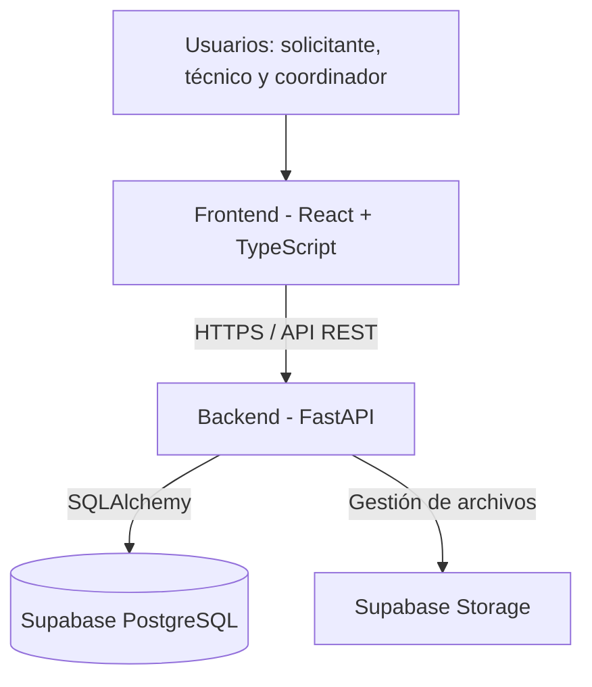
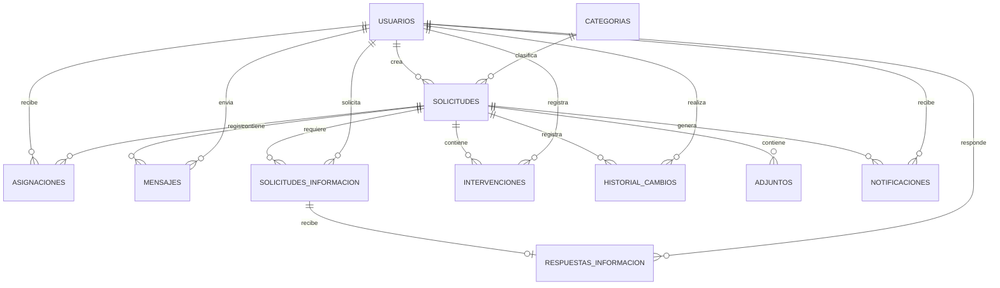

# Diseño de la solución — SoporteTI

**Versión:** 1.4  
**Estado:** Diseño técnico revisado  
**Proyecto:** SoporteTI  
**Asignatura:** Aplicaciones y Servicios Web  
**Institución:** Instituto Tecnológico Metropolitano (ITM)

---

## 1. Introducción

Este documento describe el diseño técnico de SoporteTI, una plataforma web para gestionar solicitudes de soporte técnico dentro de una organización.

La plataforma permitirá que los solicitantes registren problemas, consulten el estado de sus solicitudes y se comuniquen con el personal de soporte. Los técnicos podrán atender los casos que les sean asignados, registrar intervenciones y documentar soluciones. Los coordinadores tendrán acceso a la administración general de la plataforma.

El documento establece la arquitectura, las tecnologías, los módulos, el modelo de datos, los mecanismos de seguridad y la organización del proyecto que orientarán el desarrollo.

## 2. Objetivo del diseño

Definir una arquitectura que permita desarrollar una aplicación web organizada, segura y mantenible, utilizando tecnologías que faciliten la implementación de los requisitos funcionales y no funcionales establecidos en `docs/requisitos.md`.

Se busca separar las responsabilidades de presentación, lógica de negocio y almacenamiento de información, evitando que las reglas del sistema dependan directamente del frontend.

## 3. Arquitectura general

Se utilizará una arquitectura cliente-servidor organizada en tres capas:

1. **Presentación:** interfaz web utilizada por solicitantes, técnicos y coordinadores.
2. **Lógica de negocio:** backend encargado de procesar solicitudes, validar permisos y ejecutar las reglas del sistema.
3. **Datos:** base de datos y almacenamiento de archivos administrados mediante Supabase.

### 3.1. Componentes principales

| Componente | Tecnología | Responsabilidad |
|---|---|---|
| Frontend | React + TypeScript | Presentar la interfaz y permitir la interacción de los usuarios. |
| Backend | Python + FastAPI | Exponer la API, validar permisos y ejecutar las reglas de negocio. |
| Base de datos | PostgreSQL | Almacenar usuarios, solicitudes, mensajes, intervenciones e historial. |
| Plataforma de base de datos | Supabase | Proporcionar la infraestructura de PostgreSQL. |
| Almacenamiento de archivos | Supabase Storage | Conservar las imágenes adjuntas. |
| Control de versiones | Git + GitHub | Mantener el código y facilitar el trabajo colaborativo. |

### 3.2. Diagrama de arquitectura



### 3.3. Funcionamiento de la arquitectura

1. El usuario accede a la plataforma desde un navegador.
2. El frontend presenta las funcionalidades correspondientes a su rol.
3. Las operaciones se envían al backend mediante solicitudes HTTP.
4. FastAPI valida la sesión, los permisos y las reglas de negocio.
5. El backend consulta o modifica la información en PostgreSQL.
6. Cuando se requiere almacenar una imagen, el backend valida el archivo y gestiona su almacenamiento en Supabase Storage.
7. El resultado de cada operación se devuelve al frontend.

El frontend no realizará consultas directas a las tablas de la aplicación ni tendrá acceso a credenciales administrativas de Supabase.

## 4. Tecnologías seleccionadas

| Tecnología | Utilización |
|---|---|
| Python | Lenguaje del backend. |
| FastAPI | Desarrollo de la API REST. |
| React | Desarrollo de la interfaz web. |
| TypeScript | Tipado estático del frontend. |
| Tailwind CSS | Estilos y diseño de la interfaz. |
| PostgreSQL | Base de datos relacional. |
| Supabase | Administración de PostgreSQL y almacenamiento de archivos. |
| SQLAlchemy | Mapeo objeto-relacional. |
| Alembic | Control de migraciones de la base de datos. |
| Pydantic | Validación de datos en el backend. |
| React Router | Navegación entre páginas. |
| Pytest | Pruebas automatizadas del backend. |
| Git y GitHub | Control de versiones y colaboración. |

Las versiones concretas de las dependencias se establecerán durante la configuración inicial del proyecto.

## 5. Diseño del backend

El backend será responsable de implementar las reglas de negocio y proporcionar los servicios necesarios para el funcionamiento de la plataforma.

Se utilizará FastAPI para exponer los endpoints que consumirá el frontend.

### 5.1. Módulos funcionales

**Autenticación y usuarios**
- Inicio y cierre de sesión.
- Consulta del usuario autenticado.
- Administración de cuentas.
- Asignación de roles.
- Activación y desactivación de usuarios.
- Gestión de sesiones.

**Solicitudes**
- Registro y consulta de solicitudes.
- Clasificación por tipo y categoría.
- Gestión de prioridades y estados.
- Cancelación y cierre según los permisos establecidos.

**Asignaciones**
- Asignación de solicitudes a técnicos.
- Reasignación de solicitudes.
- Consulta del historial de asignaciones.

**Atención técnica**
- Registro de intervenciones.
- Documentación de diagnósticos.
- Registro de soluciones.
- Clasificación de intervenciones como internas o visibles para el solicitante.

**Información adicional**
- Registro de peticiones de información.
- Consulta de peticiones por parte del solicitante.
- Registro de respuestas.
- Asociación de las peticiones y respuestas con la solicitud correspondiente.

**Conversaciones**
- Envío y consulta de mensajes.
- Asociación de mensajes con una solicitud.
- Comunicación entre solicitantes, técnicos asignados y coordinadores.
- Restricción de nuevos mensajes cuando una solicitud se encuentre cerrada.

**Categorías**
- Consulta, creación y modificación de categorías.
- Activación y desactivación de categorías.

**Historial**
- Registro de cambios relevantes.
- Consulta de modificaciones realizadas.
- Identificación del usuario responsable de cada operación.

**Estadísticas**
- Consulta de solicitudes por estado.
- Consulta de solicitudes por prioridad y categoría.
- Consulta de cantidades y tiempos de atención cuando exista información suficiente.

### 5.2. Diseño preliminar de la API

La API seguirá una arquitectura REST y utilizará JSON para intercambiar información.

Se utilizará el prefijo `/api/v1` para identificar la primera versión de la API.

Se mantendrá una convención de rutas en inglés para los recursos y operaciones de la API. Los nombres de las tablas y campos de la base de datos podrán mantenerse en español.

| Método | Endpoint | Descripción |
|---|---|---|
| POST | `/api/v1/auth/login` | Iniciar sesión. |
| POST | `/api/v1/auth/logout` | Cerrar sesión. |
| GET | `/api/v1/auth/me` | Consultar usuario autenticado. |
| GET | `/api/v1/users` | Consultar usuarios. |
| POST | `/api/v1/users` | Crear usuarios. |
| GET | `/api/v1/users/{id}` | Consultar un usuario. |
| PATCH | `/api/v1/users/{id}` | Modificar datos permitidos. |
| GET | `/api/v1/categories` | Consultar categorías. |
| POST | `/api/v1/categories` | Crear categorías. |
| PATCH | `/api/v1/categories/{id}` | Modificar categorías. |
| GET | `/api/v1/requests` | Consultar solicitudes autorizadas. |
| POST | `/api/v1/requests` | Registrar una solicitud. |
| GET | `/api/v1/requests/{id}` | Consultar el detalle de una solicitud. |
| PATCH | `/api/v1/requests/{id}` | Modificar información permitida. |
| PATCH | `/api/v1/requests/{id}/status` | Cambiar el estado de una solicitud. |
| POST | `/api/v1/requests/{id}/assignments` | Asignar o reasignar un técnico. |
| POST | `/api/v1/requests/{id}/interventions` | Registrar una intervención. |
| POST | `/api/v1/requests/{id}/information-requests` | Solicitar información adicional. |
| POST | `/api/v1/information-requests/{id}/responses` | Responder una petición de información. |
| GET | `/api/v1/requests/{id}/messages` | Consultar conversación. |
| POST | `/api/v1/requests/{id}/messages` | Enviar un mensaje. |
| POST | `/api/v1/requests/{id}/resolve` | Registrar la solución. |
| POST | `/api/v1/requests/{id}/close` | Cerrar una solicitud. |
| POST | `/api/v1/requests/{id}/cancel` | Cancelar una solicitud. |
| GET | `/api/v1/requests/{id}/history` | Consultar historial. |
| POST | `/api/v1/requests/{id}/attachments` | Adjuntar una imagen a una solicitud. |
| GET | `/api/v1/statistics` | Consultar estadísticas. |

Esta tabla es una propuesta inicial de recursos y operaciones. Los parámetros, cuerpos de petición, respuestas, permisos y errores se definirán detalladamente en `docs/contrato-api.md` antes de implementar los endpoints.

### 5.3. Respuestas y manejo de errores

La API utilizará códigos HTTP adecuados para indicar el resultado de cada operación:

| Código | Significado |
|---|---|
| 200 | Operación realizada correctamente. |
| 201 | Recurso creado. |
| 204 | Operación completada sin contenido de respuesta. |
| 400 | Solicitud inválida. |
| 401 | Usuario no autenticado. |
| 403 | Usuario sin permisos. |
| 404 | Recurso no encontrado. |
| 409 | Conflicto con el estado actual del recurso. |
| 422 | Datos que no cumplen las validaciones. |
| 500 | Error interno del servidor. |

Las respuestas de error tendrán una estructura consistente y no expondrán información interna ni datos sensibles.

### 5.4. Paginación y filtros

Los listados de solicitudes, usuarios, mensajes e historiales utilizarán paginación para evitar cargar grandes cantidades de información en una sola petición.

Se podrán implementar filtros por:

- Estado.
- Prioridad.
- Categoría.
- Tipo de solicitud.
- Técnico asignado.
- Solicitante.
- Fecha de creación.
- Fecha de cierre.
- Tipo de cierre.

La API deberá validar los parámetros de paginación y limitar la cantidad máxima de registros devueltos.

## 6. Diseño de la base de datos

Se utilizará PostgreSQL mediante Supabase.

La base de datos será relacional y estará organizada para mantener la integridad de la información, evitar duplicidad innecesaria y permitir consultar el historial de atención de cada solicitud.

Se utilizarán identificadores UUID como claves primarias y campos de fecha con zona horaria para conservar correctamente los registros temporales.

### 6.1. Entidades principales

#### 6.1.1. usuarios

Almacena las cuentas de las personas que utilizan la plataforma.

Campos propuestos:

- `id`: UUID, clave primaria.
- `nombre`: nombre del usuario.
- `apellido`: apellido del usuario.
- `correo`: correo electrónico único.
- `password_hash`: hash de la contraseña.
- `rol`: solicitante, técnico o coordinador.
- `activo`: indica si la cuenta está habilitada.
- `medio_contacto_preferido`: correo electrónico o teléfono.
- `telefono`: número de contacto, cuando corresponda.
- `fecha_creacion`: fecha de creación.
- `fecha_actualizacion`: última modificación.

Las cuentas serán creadas por el coordinador. No existirá registro público.

#### 6.1.2. categorias

Almacena las categorías disponibles para clasificar las solicitudes.

Campos propuestos:

- `id`: UUID, clave primaria.
- `nombre`: nombre de la categoría.
- `descripcion`: descripción.
- `activa`: indica si puede utilizarse.
- `fecha_creacion`: fecha de creación.

#### 6.1.3. solicitudes

Contiene la información principal de cada solicitud de soporte.

Campos propuestos:

- `id`: UUID, clave primaria.
- `numero`: identificador legible y único de la solicitud.
- `titulo`: título del problema.
- `descripcion`: descripción del problema.
- `tipo`: incidente o requerimiento.
- `solicitante_id`: usuario que registra la solicitud.
- `categoria_id`: categoría asociada.
- `prioridad`: baja, media o alta.
- `estado`: estado actual.
- `ubicacion`: lugar donde se encuentra el equipo o donde ocurre el problema.
- `placa_equipo`: placa o identificador del equipo, cuando corresponda.
- `medio_contacto`: medio de contacto indicado para la solicitud.
- `dato_contacto`: correo o teléfono correspondiente, cuando aplique.
- `tipo_cierre`: solución, cancelación o administrativo, cuando corresponda.
- `motivo_cierre`: explicación del cierre, cuando aplique.
- `fecha_creacion`: fecha de registro.
- `fecha_actualizacion`: última modificación.
- `fecha_cierre`: fecha de cierre, cuando corresponda.
- `cerrado_por`: usuario responsable del cierre.
- `solucion_final`: resumen de la solución definitiva, cuando exista.

El técnico responsable se obtendrá de la tabla de asignaciones activas, evitando mantener el mismo dato duplicado en dos tablas.

#### 6.1.4. asignaciones

Registra las asignaciones y reasignaciones de técnicos.

Campos propuestos:

- `id`: UUID, clave primaria.
- `solicitud_id`: solicitud asociada.
- `tecnico_id`: técnico asignado.
- `asignado_por`: coordinador que realiza la operación.
- `fecha_asignacion`: fecha de asignación.
- `fecha_finalizacion`: fecha en que termina la asignación.
- `observacion`: motivo o comentario de la asignación.

Una solicitud podrá tener varias asignaciones históricas, pero solamente una asignación activa a la vez.

#### 6.1.5. mensajes

Almacena los mensajes intercambiados durante la atención de una solicitud.

Campos propuestos:

- `id`: UUID, clave primaria.
- `solicitud_id`: solicitud asociada.
- `remitente_id`: usuario que envía el mensaje.
- `contenido`: contenido del mensaje.
- `fecha_envio`: fecha y hora de envío.

Los mensajes pertenecerán a la conversación de la solicitud y podrán ser consultados por el solicitante, el técnico asignado y el coordinador, según sus permisos.

#### 6.1.6. solicitudes_informacion

Almacena las peticiones de información adicional realizadas por el técnico o el coordinador.

Campos propuestos:

- `id`: UUID, clave primaria.
- `solicitud_id`: solicitud relacionada.
- `solicitado_por`: usuario que solicita la información.
- `contenido`: descripción de la información requerida.
- `fecha_solicitud`: fecha de creación de la petición.
- `estado`: pendiente o respondida.

Esta entidad permite identificar cada petición y conocer si el solicitante ya respondió.

#### 6.1.7. respuestas_informacion

Almacena las respuestas del solicitante a las peticiones de información adicional.

Campos propuestos:

- `id`: UUID, clave primaria.
- `solicitud_informacion_id`: petición a la que responde.
- `respondido_por`: usuario que envía la respuesta.
- `contenido`: respuesta proporcionada.
- `fecha_respuesta`: fecha y hora de la respuesta.

Una petición podrá tener una respuesta principal asociada. Si se requiere una ampliación de la información, podrá generarse una nueva petición.

#### 6.1.8. intervenciones

Registra las actividades realizadas por el personal técnico.

Campos propuestos:

- `id`: UUID, clave primaria.
- `solicitud_id`: solicitud asociada.
- `tecnico_id`: técnico que registra la intervención.
- `descripcion`: actividad realizada.
- `diagnostico`: diagnóstico técnico, cuando corresponda.
- `solucion`: solución aplicada, cuando corresponda.
- `tipo`: clasificación de la intervención.
- `visible_solicitante`: indica si el solicitante puede consultarla.
- `fecha_registro`: fecha y hora del registro.

Las intervenciones se mantendrán separadas de los mensajes de conversación.

#### 6.1.9. historial_cambios

Registra las modificaciones relevantes realizadas sobre las solicitudes.

Campos propuestos:

- `id`: UUID, clave primaria.
- `solicitud_id`: solicitud afectada.
- `usuario_id`: usuario que realiza el cambio.
- `tipo_cambio`: tipo de modificación.
- `valor_anterior`: valor previo, cuando corresponda.
- `valor_nuevo`: nuevo valor, cuando corresponda.
- `observacion`: descripción adicional.
- `fecha_cambio`: fecha y hora del cambio.

Se utilizará para registrar cambios de estado, prioridad, categoría, asignaciones, cierres y cancelaciones.

La tabla de asignaciones conservará el detalle de cada asignación; el historial general permitirá consultar los cambios como parte de la evolución de la solicitud.

#### 6.1.10. adjuntos

Almacena los metadatos de los archivos relacionados con solicitudes, mensajes o intervenciones.

Campos propuestos:

- `id`: UUID, clave primaria.
- `solicitud_id`: solicitud asociada.
- `mensaje_id`: mensaje asociado, si corresponde.
- `intervencion_id`: intervención asociada, si corresponde.
- `nombre_archivo`: nombre original del archivo.
- `ruta_storage`: ubicación del archivo en Supabase Storage.
- `tipo_archivo`: formato del archivo.
- `tamano`: tamaño del archivo en bytes.
- `subido_por`: usuario que carga el archivo.
- `fecha_subida`: fecha y hora de subida.

Cada adjunto deberá estar asociado a una solicitud y, opcionalmente, a un mensaje o intervención. Se establecerán restricciones para evitar asociaciones ambiguas.

El archivo físico se almacenará en Supabase Storage. PostgreSQL conservará únicamente sus metadatos y su ruta.

#### 6.1.11. notificaciones

La tabla de notificaciones podrá utilizarse para registrar avisos generados para los usuarios cuando se implemente este módulo.

Campos propuestos:

- `id`: UUID, clave primaria.
- `usuario_id`: usuario destinatario.
- `solicitud_id`: solicitud relacionada, cuando corresponda.
- `tipo`: tipo de notificación.
- `contenido`: descripción del aviso.
- `canal`: plataforma o correo.
- `estado_envio`: estado del envío.
- `leida`: indica si el usuario la ha leído en la plataforma.
- `fecha_creacion`: fecha de creación.
- `fecha_envio`: fecha de envío, cuando corresponda.

Su implementación podrá realizarse después de completar los flujos principales.

### 6.2. Relaciones principales

- Un usuario solicitante puede registrar múltiples solicitudes.
- Una categoría puede estar asociada a múltiples solicitudes.
- Una solicitud puede tener diferentes asignaciones a lo largo del tiempo.
- Un técnico puede tener múltiples asignaciones.
- Una solicitud puede tener múltiples mensajes.
- Un usuario puede enviar múltiples mensajes.
- Una solicitud puede tener múltiples peticiones de información.
- Una petición de información pertenece a una solicitud.
- Una petición puede tener una respuesta asociada.
- Una solicitud puede tener múltiples intervenciones.
- Un técnico puede registrar múltiples intervenciones.
- Una solicitud puede tener múltiples registros de historial.
- Una solicitud puede tener múltiples archivos adjuntos.
- Un usuario puede recibir múltiples notificaciones.

### 6.3. Diagrama entidad-relación preliminar



Este modelo es preliminar. Durante la implementación se definirán los tipos de datos, restricciones, índices, claves foráneas y reglas de integridad.

### 6.4. Restricciones de integridad

Se establecerán restricciones para garantizar la consistencia de la información:

- El correo electrónico de cada usuario será único.
- Los roles estarán limitados a solicitante, técnico y coordinador.
- Los tipos de solicitud estarán limitados a incidente y requerimiento.
- Los estados, prioridades y tipos de cierre utilizarán valores controlados.
- Las solicitudes deberán tener un solicitante válido.
- Las asignaciones solo podrán asociar técnicos activos.
- Una solicitud no podrá tener más de una asignación activa.
- Los mensajes deberán pertenecer a una solicitud existente.
- Las peticiones y respuestas de información deberán pertenecer a solicitudes existentes.
- Las intervenciones deberán estar asociadas a una solicitud existente.
- Los archivos adjuntos deberán tener una asociación válida.
- Los registros históricos no se modificarán desde las operaciones normales de la aplicación.
- Las solicitudes cerradas no admitirán nuevas operaciones de atención.
- Una solicitud con estado `Cerrado` deberá tener tipo y fecha de cierre.
- El tipo de cierre deberá distinguir entre solución, cancelación y administrativo.

Las reglas que involucren varias tablas se validarán mediante transacciones y lógica de negocio en el backend, utilizando restricciones adicionales cuando sea posible.

## 7. Diseño de los estados y transiciones

Los estados representan el ciclo de vida de una solicitud.

| Estado | Descripción |
|---|---|
| Registrado | Solicitud recién creada y pendiente de evaluación. |
| En evaluación | Solicitud pendiente de revisión y clasificación por el coordinador. |
| Asignado | Solicitud asignada a un técnico, pero cuya atención todavía no ha comenzado. |
| En atención | El técnico está trabajando en el caso. |
| En espera | La atención está detenida temporalmente, por ejemplo, por falta de información. |
| Resuelto | El técnico ha registrado una solución y está pendiente de revisión o cierre por el coordinador. |
| Cerrado | Solicitud finalizada o cancelada. No admite nuevas operaciones. |

### 7.1. Matriz de transiciones

Esta tabla es la referencia única para validar los cambios de estado en el sistema. Debe mantenerse alineada con `docs/requisitos.md`.

| Estado actual | Estado destino | Responsable | Condición |
|---|---|---|---|
| Registrado | En evaluación | Coordinador | Inicio de evaluación. |
| Registrado | Cerrado | Solicitante | Tipo de cierre: Cancelación. |
| En evaluación | Asignado | Coordinador | Debe existir un técnico asignado. |
| En evaluación | Cerrado | Solicitante | Tipo de cierre: Cancelación. |
| En evaluación | Cerrado | Coordinador | Tipo de cierre: Administrativo y motivo obligatorio. |
| Asignado | En atención | Técnico asignado | Inicio de la atención. |
| En atención | En espera | Técnico asignado | Se requiere detener temporalmente la atención. |
| En espera | En atención | Técnico asignado | Se puede continuar la atención. |
| En atención | Resuelto | Técnico asignado | Debe registrar la solución. |
| En espera | Resuelto | Técnico asignado | Debe registrar la solución. |
| Resuelto | Cerrado | Coordinador | Tipo de cierre: Solución. |

Las transiciones no incluidas en esta tabla no estarán permitidas.

### 7.2. Reglas de transición

- Una solicitud nueva inicia en `Registrado`.
- El coordinador puede iniciar su evaluación.
- El coordinador puede asignar un técnico cuando la solicitud esté en `En evaluación`.
- El técnico asignado puede iniciar la atención.
- El técnico asignado puede pasar la solicitud a `En espera` cuando necesite detener temporalmente la atención.
- El técnico asignado puede continuar la atención desde `En espera`.
- El técnico asignado puede registrar una solución y pasar la solicitud a `Resuelto`.
- El coordinador revisa la solución y cierra la solicitud.
- El solicitante puede cancelar únicamente en los estados permitidos.
- El coordinador puede realizar un cierre administrativo durante la evaluación.
- Una solicitud cerrada no puede reabrirse.
- Si aparece un nuevo problema, se debe crear otra solicitud.

Enviar un mensaje o responder una petición de información no cambia automáticamente el estado de la solicitud.

### 7.3. Tipos de cierre

Se contemplan tres tipos:

- **Solución:** la solicitud fue atendida y el problema fue resuelto. El cierre lo realiza el coordinador después de revisar la solución registrada.
- **Cancelación:** el solicitante decidió cancelar la solicitud cuando todavía se encontraba en `Registrado` o `En evaluación`.
- **Administrativo:** el coordinador determinó que la solicitud debe cerrarse por una causa administrativa. Debe registrarse el motivo correspondiente.

El tipo de cierre, el responsable, la fecha y el motivo cuando aplique deberán conservarse en la información de la solicitud y en su historial.

## 8. Diseño de las interfaces

La interfaz se desarrollará con React y TypeScript. Se utilizará una estructura visual consistente y se mostrarán las opciones de acuerdo con el rol del usuario autenticado.

### 8.1. Interfaz del solicitante

El solicitante contará con las siguientes vistas:

**Inicio**
- Resumen de sus solicitudes.
- Solicitudes recientes.
- Acceso al formulario para crear una solicitud.

**Crear solicitud**
- Título y descripción.
- Tipo de solicitud.
- Categoría.
- Ubicación.
- Placa o identificador del equipo cuando corresponda.
- Datos de contacto.
- Adjuntos de imágenes.

**Mis solicitudes**
- Listado de solicitudes propias.
- Estado y prioridad.
- Filtros y búsqueda.

**Detalle de solicitud**
- Información del caso.
- Estado actual.
- Técnico asignado, cuando corresponda.
- Conversación.
- Peticiones de información adicional y formulario para responder.
- Intervenciones visibles para el solicitante.
- Historial consultable según los permisos.
- Opción de cancelar cuando el estado lo permita.

### 8.2. Interfaz del técnico

El técnico contará con:

**Inicio**
- Resumen de solicitudes asignadas.
- Solicitudes pendientes de atención.
- Solicitudes en espera.

**Solicitudes asignadas**
- Listado de casos asignados.
- Filtros por estado y prioridad.
- Acceso al detalle de cada solicitud.

**Detalle de solicitud**
- Información del solicitante y del problema.
- Datos del equipo y ubicación.
- Conversación.
- Peticiones de información adicional.
- Registro de intervenciones.
- Diagnóstico y solución.
- Acciones permitidas según el estado.

El técnico no tendrá opciones para asignar solicitudes ni cerrar casos.

### 8.3. Interfaz del coordinador

El coordinador contará con:

**Panel principal**
- Resumen de solicitudes.
- Cantidades por estado.
- Solicitudes pendientes de evaluación.
- Solicitudes pendientes de revisión.

**Gestión de solicitudes**
- Listado general.
- Búsqueda y filtros.
- Evaluación y clasificación.
- Asignación y reasignación.
- Revisión de intervenciones y soluciones.
- Cierre por solución o administrativo.

**Gestión de usuarios**
- Creación de cuentas.
- Consulta y modificación.
- Activación y desactivación.
- Asignación de roles.

**Gestión de categorías**
- Creación y modificación.
- Activación y desactivación.

**Estadísticas**
- Solicitudes por estado.
- Solicitudes por prioridad.
- Solicitudes por categoría.
- Información general sobre tiempos de atención.

## 9. Autenticación y autorización

La autenticación y autorización se implementarán en el backend.

### 9.1. Autenticación

El sistema permitirá iniciar sesión mediante correo electrónico y contraseña.

Las contraseñas se almacenarán utilizando un algoritmo seguro de hash diseñado para contraseñas.

El backend validará las credenciales y establecerá una sesión para el usuario autenticado.

### 9.2. Gestión de sesiones

Se utilizarán cookies protegidas con las siguientes características:

- `HttpOnly`: evita el acceso desde JavaScript.
- `Secure`: obliga al uso de HTTPS en producción.
- `SameSite`: reduce riesgos de solicitudes cruzadas.
- Duración limitada de la sesión.

El mecanismo de sesión deberá permitir invalidar sesiones al cerrar sesión y al desactivar una cuenta.

Se implementarán medidas contra CSRF cuando el mecanismo de cookies utilizado lo requiera.

### 9.3. Administración de cuentas

El coordinador será responsable de crear las cuentas de los usuarios.

No se permitirá el registro público.

La recuperación de acceso y el cambio de contraseña se implementarán mediante un procedimiento seguro cuando se complete ese módulo.

### 9.4. Autorización por roles

Cada endpoint verificará el rol del usuario y, cuando corresponda, su relación con la solicitud.

Reglas principales:

- El solicitante solo podrá consultar y gestionar sus propias solicitudes dentro de los permisos establecidos.
- El técnico solo podrá consultar y atender solicitudes que tenga asignadas actualmente.
- El coordinador podrá consultar y administrar todas las solicitudes.
- Solamente el coordinador podrá cerrar solicitudes por solución o por causas administrativas.
- El solicitante podrá cancelar en los estados permitidos.
- Ningún usuario podrá enviar mensajes o registrar intervenciones en solicitudes cerradas.
- Los datos internos de una intervención no serán visibles para el solicitante.
- El técnico que deje de tener asignada una solicitud perderá el acceso operativo a su conversación e intervenciones internas.

Ocultar botones en el frontend no será considerado una medida de seguridad suficiente. Los permisos deberán comprobarse en el backend.

## 10. Integración con Supabase

Supabase será utilizado para administrar PostgreSQL y almacenar archivos.

### 10.1. Conexión con PostgreSQL

FastAPI utilizará SQLAlchemy para comunicarse con PostgreSQL.

La conexión se configurará mediante variables de entorno, evitando almacenar credenciales directamente en el código.

Alembic será utilizado para gestionar las migraciones de la base de datos.

### 10.2. Responsabilidades

**Supabase:**
- Administración de PostgreSQL.
- Infraestructura de almacenamiento.
- Gestión de buckets y archivos.
- Herramientas de administración de la base de datos.

**FastAPI:**
- Validación de credenciales.
- Autenticación y sesiones.
- Autorización por roles.
- Reglas de negocio.
- Consultas y transacciones.
- Gestión y validación de archivos.
- Registro de información.

### 10.3. Protección de credenciales

Las credenciales de conexión y las claves privadas de Supabase permanecerán exclusivamente en el backend.

No se expondrán al frontend claves administrativas ni cadenas de conexión.

Se utilizarán variables de entorno para almacenar:

- URL o cadena de conexión de PostgreSQL.
- Credenciales de acceso a la base de datos.
- Credenciales privadas necesarias para Storage.
- Claves de firma de sesiones.

El archivo `.env` no se subirá al repositorio. Se proporcionará un `.env.example` sin credenciales reales para documentar las variables necesarias.

## 11. Almacenamiento de archivos e imágenes

Los archivos adjuntos se almacenarán en Supabase Storage utilizando un bucket privado.

La base de datos conservará los metadatos y la ubicación de los archivos, no su contenido binario.

### 11.1. Formatos y restricciones

Para la primera versión se establecerán las siguientes condiciones:

- Formatos permitidos: PNG y JPG/JPEG.
- Tamaño máximo: 5 MB por archivo.
- Los archivos deberán corresponder realmente a imágenes válidas.
- Los archivos se asociarán a una solicitud y, cuando corresponda, a un mensaje o intervención.

### 11.2. Validaciones

FastAPI será responsable de validar cada archivo recibido.

Se comprobará:

- Que el usuario tenga permiso para adjuntarlo.
- Que el contenido corresponda a una imagen válida.
- Que el formato esté permitido.
- Que el tamaño no supere el límite establecido.

No se confiará exclusivamente en la extensión del archivo ni en el tipo MIME declarado por el frontend.

Se utilizarán nombres únicos para los archivos almacenados, evitando sobrescribir archivos existentes.

### 11.3. Almacenamiento y acceso

Los archivos se guardarán en un bucket privado de Supabase Storage.

No se habilitará el acceso público directo a los adjuntos.

El acceso a los archivos se realizará mediante el backend o enlaces temporales autorizados, después de comprobar los permisos del usuario.

La ruta de almacenamiento y los metadatos del archivo se registrarán en PostgreSQL.

### 11.4. Conservación

Cerrar una solicitud no eliminará las imágenes ni los documentos asociados.

Los archivos se conservarán como parte del historial y de las evidencias de atención de la solicitud.

La eliminación de archivos deberá ser una operación controlada que compruebe los permisos y mantenga la integridad entre Storage y PostgreSQL.

La conversión a WebP, el redimensionamiento automático y la limpieza automatizada de archivos huérfanos se consideran mejoras posteriores, no condiciones para completar los flujos principales de la primera versión.

## 12. Comunicación y notificaciones

La plataforma será el medio principal de comunicación entre los solicitantes y el personal de soporte.

Se diferenciarán tres mecanismos.

### 12.1. Conversación

- Cada solicitud tendrá una conversación independiente.
- El solicitante podrá comunicarse con el técnico asignado y el coordinador.
- El técnico podrá comunicarse únicamente en las solicitudes que tenga asignadas.
- El coordinador podrá consultar y participar en todas las conversaciones.
- El solicitante podrá enviar mensajes durante toda la atención de una solicitud abierta, incluso cuando esté en espera.
- Enviar un mensaje no cambiará automáticamente el estado.
- La conversación se bloqueará cuando la solicitud esté cerrada.
- El historial de mensajes permanecerá disponible para consulta autorizada.

### 12.2. Solicitudes de información adicional

El mecanismo permitirá que el técnico o el coordinador indique qué información necesita para evaluar o continuar el caso.

El funcionamiento será:

1. El técnico asignado o el coordinador registra una petición de información.
2. El sistema conserva el contenido, autor y fecha de la petición.
3. El solicitante consulta la petición desde su solicitud.
4. El solicitante envía una respuesta asociada a esa petición.
5. El personal autorizado consulta la respuesta y continúa el proceso.

Cuando la atención técnica quede pendiente de esa información, el técnico podrá cambiar el estado a `En espera`.

Las peticiones y respuestas se almacenarán en entidades propias, separadas de los mensajes generales de conversación.

### 12.3. Intervenciones técnicas

- Registro de actividades realizadas por el técnico.
- Documentación de diagnósticos y soluciones.
- Clasificación como internas o visibles para el solicitante.
- Conservación del historial de actividades.

### 12.4. Notificaciones

Las notificaciones por correo podrán incorporarse para informar sobre eventos relevantes.

El correo será un canal de aviso. Las respuestas y comunicaciones relacionadas con las solicitudes se gestionarán desde la plataforma.

La implementación de notificaciones automáticas podrá realizarse después de completar los flujos principales.

### 12.5. Actualización de conversaciones

La primera versión utilizará API REST para:

- Enviar mensajes.
- Consultar conversaciones.
- Recuperar mensajes anteriores.
- Actualizar la vista de conversación mediante nuevas consultas.

No se implementará WebSocket en la primera versión. La comunicación en tiempo real se considera una mejora futura.

## 13. Historial y auditoría

La plataforma conservará registros de las operaciones relevantes para permitir el seguimiento de las solicitudes.

Se registrarán, como mínimo:

- Creación de solicitudes.
- Cambios de estado.
- Cambios de prioridad.
- Cambios de categoría.
- Asignaciones y reasignaciones.
- Registro de soluciones.
- Cierre por solución.
- Cancelación por parte del solicitante.
- Cierre administrativo por parte del coordinador.
- Modificaciones administrativas relevantes.

Cada registro incluirá el usuario responsable y la fecha de la operación.

Los registros históricos no podrán ser modificados desde las funcionalidades normales de la aplicación.

Los mensajes, las peticiones de información y las intervenciones conservarán sus propias entidades y no serán sustituidos por el historial de cambios.

La cancelación y los cierres por solución o por causa administrativa deberán poder distinguirse al consultar el historial.

## 14. Seguridad y protección de datos

Se aplicarán las siguientes medidas:

- Uso de HTTPS en producción.
- Hash seguro de contraseñas.
- Cookies protegidas para las sesiones.
- Validación de datos recibidos.
- Autorización en cada operación protegida.
- Protección frente a consultas no autorizadas.
- Variables sensibles almacenadas en el entorno del backend.
- Restricción de acceso a archivos adjuntos.
- Validación de formatos, contenidos y tamaños de archivos.
- Manejo controlado de errores.
- Registro de operaciones importantes.
- Protección contra CSRF cuando corresponda.
- Restricción de acceso a recursos según el rol.

Se evitará almacenar información sensible innecesaria y se limitará el acceso a los datos de acuerdo con las responsabilidades de cada usuario.

## 15. Integridad y consistencia de la información

Las operaciones que modifiquen información relacionada se realizarán mediante transacciones cuando sea necesario.

Por ejemplo:

- Asignar un técnico y registrar el cambio en el historial.
- Cambiar el estado y registrar la transición.
- Registrar una solución y actualizar el estado correspondiente.
- Cerrar una solicitud y conservar el responsable, tipo y fecha de cierre.
- Cancelar una solicitud y registrar el motivo.
- Registrar los metadatos de un archivo después de confirmar su almacenamiento.

Se implementarán controles para evitar inconsistencias cuando dos usuarios intenten modificar simultáneamente una solicitud.

Las operaciones deberán comprobar el estado actual antes de ejecutarse. Si una operación ya no es válida, el backend devolverá un conflicto y no realizará modificaciones parciales.

La creación de registros relacionados deberá mantener la integridad referencial mediante claves foráneas y transacciones.

## 16. Organización del proyecto

El repositorio utilizará una estructura separada para frontend, backend, documentación y evidencias.

```text
SoporteTI/
│
├── apps/
│   ├── backend/
│   │   ├── app/
│   │   │   ├── api/
│   │   │   │   └── v1/
│   │   │   ├── core/
│   │   │   ├── database/
│   │   │   ├── models/
│   │   │   ├── schemas/
│   │   │   ├── services/
│   │   │   └── main.py
│   │   ├── tests/
│   │   ├── alembic/
│   │   └── requirements.txt
│   │
│   └── frontend/
│       ├── src/
│       │   ├── components/
│       │   ├── pages/
│       │   ├── layouts/
│       │   ├── services/
│       │   ├── hooks/
│       │   ├── routes/
│       │   └── types/
│       └── package.json
│
├── docs/
│   ├── requisitos.md
│   ├── diseno.md
│   ├── contrato-api.md
│   ├── guia-desarrollo.md
│   ├── trazabilidad.md
│   └── pruebas.md
│
├── evidencias/
│   └── entrevista/
│
├── .env.example
├── .gitignore
└── README.md
```

### 16.1. Organización interna del backend

- `api/`: definición de endpoints y rutas.
- `core/`: configuración, seguridad y funciones generales.
- `database/`: conexión y sesiones de base de datos.
- `models/`: modelos de SQLAlchemy.
- `schemas/`: esquemas Pydantic.
- `services/`: lógica de negocio.
- `tests/`: pruebas automatizadas.
- `alembic/`: migraciones de la base de datos.

### 16.2. Organización interna del frontend

- `components/`: componentes reutilizables.
- `pages/`: páginas principales.
- `layouts/`: estructuras visuales por rol.
- `services/`: comunicación con la API.
- `hooks/`: hooks personalizados.
- `routes/`: configuración de rutas y protección de navegación.
- `types/`: tipos e interfaces de TypeScript.

## 17. Estrategia de pruebas

Se realizarán pruebas durante el desarrollo y al finalizar la integración.

### 17.1. Pruebas unitarias

Se probarán de forma aislada:

- Validación de datos.
- Reglas de cambio de estado.
- Validación de permisos.
- Funciones de los servicios.
- Reglas de asignación.
- Validación de solicitudes cerradas.
- Diferenciación entre tipos de cierre.

### 17.2. Pruebas de integración

Se verificará el funcionamiento conjunto de:

- FastAPI y PostgreSQL.
- Registro y consulta de solicitudes.
- Asignación de técnicos.
- Registro de mensajes e intervenciones.
- Solicitudes y respuestas de información adicional.
- Gestión de archivos en Supabase Storage.
- Registro de cambios en el historial.
- Restricciones de acceso a conversaciones.
- Gestión de sesiones.

### 17.3. Pruebas funcionales

Se documentarán 12 pruebas funcionales principales en `docs/pruebas.md`.

| ID | Prueba | Resultado esperado | Criterio |
|---|---|---|---|
| PF-01 | Inicio de sesión con credenciales válidas e inválidas. | Permite el acceso con credenciales válidas y rechaza las incorrectas. | CA-01 |
| PF-02 | Acceso a funcionalidades según el rol. | Cada usuario accede únicamente a las operaciones permitidas. | CA-01 |
| PF-03 | Creación de usuarios por el coordinador. | El coordinador crea cuentas con el rol correspondiente. | CA-01 |
| PF-04 | Registro de una solicitud por un solicitante. | La solicitud se crea con los datos obligatorios y estado `Registrado`. | CA-02 |
| PF-05 | Consulta de solicitudes según el rol. | El solicitante ve las propias, el técnico las asignadas y el coordinador todas. | CA-02 |
| PF-06 | Evaluación, clasificación y prioridad. | El coordinador puede evaluar y clasificar una solicitud. | CA-03 |
| PF-07 | Asignación y reasignación de técnicos. | Se actualiza el responsable y se conserva el historial de asignaciones. | CA-03 |
| PF-08 | Registro de intervención técnica. | El técnico asignado registra una intervención y se respeta su visibilidad. | CA-04 |
| PF-09 | Solicitud y respuesta de información adicional. | El técnico o coordinador solicita información y el solicitante puede responder. | CA-04 |
| PF-10 | Registro de solución y cierre. | El técnico registra la solución y el coordinador puede cerrar la solicitud. | CA-05 |
| PF-11 | Cancelación y cierre administrativo. | Se permiten los cierres según el rol, estado y motivo correspondiente. | CA-05 |
| PF-12 | Consulta del consolidado del coordinador. | Se muestran cantidades y datos agrupados según la información registrada. | CA-06 |

Cada prueba documentada deberá incluir:

- Identificador.
- Nombre de la prueba.
- Requisito o criterio relacionado.
- Precondiciones.
- Datos de entrada.
- Pasos de ejecución.
- Resultado esperado.
- Resultado obtenido.
- Estado: aprobada o fallida.
- Evidencia, cuando corresponda.

## 18. Estrategia de desarrollo

El desarrollo se organizará por flujos funcionales completos. Cada flujo deberá integrar las operaciones del backend, persistencia de datos, interfaz y pruebas correspondientes antes de avanzar al siguiente.

| Orden | Flujo | Trabajo principal | Criterio relacionado |
|---|---|---|---|
| 1 | Autenticación y roles | Inicio de sesión, sesiones, usuarios y permisos. | CA-01 |
| 2 | Registro y consulta de solicitudes | Formulario, persistencia, validaciones y listados. | CA-02 |
| 3 | Evaluación y asignación | Clasificación, prioridad, asignación y estados. | CA-03 |
| 4 | Atención técnica | Intervenciones, información adicional e historial. | CA-04 |
| 5 | Resolución y cierre | Registro de soluciones, cancelación y cierres. | CA-05 |
| 6 | Consolidado del coordinador | Consultas y estadísticas básicas. | CA-06 |

Después de completar los flujos principales, se podrán incorporar las funcionalidades complementarias que permita el tiempo disponible, como:

- Adjuntos en mensajes e intervenciones.
- Notificaciones por correo.
- Actualizaciones de conversación en tiempo real.
- Conversión de imágenes a WebP.
- Mejoras de estadísticas.
- Funciones adicionales de mantenimiento.

Los adjuntos de imágenes solicitados como parte del registro de solicitudes sí forman parte del alcance funcional; las optimizaciones avanzadas de imágenes se consideran posteriores.

## 19. Trabajo colaborativo y control de versiones

El desarrollo se realizará mediante Git y GitHub, utilizando ramas para separar las funcionalidades y facilitar la integración.

La rama `main` conservará una versión estable del proyecto.

Cada integrante trabajará en ramas propias para sus funcionalidades y realizará solicitudes de integración (Pull Requests) antes de incorporar cambios a `main`.

La distribución funcional será:

- **Integrante 1:** módulo coordinador, backend y frontend; también backend del módulo solicitante.
- **Integrante 2:** módulo técnico, backend y frontend; también frontend del módulo solicitante.
- **Trabajo compartido:** autenticación, conversación, integración, contratos API, base de datos y pruebas de integración.

Los cambios que afecten entidades compartidas, permisos, contratos de API o archivos que ambos integrantes deban modificar se coordinarán antes de implementarse.

Se mantendrán las convenciones y acuerdos establecidos en `docs/guia-desarrollo.md`.

## 20. Mejoras futuras

Las siguientes funcionalidades no son necesarias para completar los flujos principales de la primera versión y podrán evaluarse posteriormente:

1. Comunicación en tiempo real mediante WebSockets.
2. Conversión y optimización de imágenes a WebP.
3. Redimensionamiento automático de imágenes.
4. Notificaciones avanzadas por correo.
5. Políticas RLS adicionales, si la arquitectura de acceso las requiere.
6. Automatización de respaldos y recuperación.
7. Limpieza automatizada de archivos huérfanos.
8. Mejoras de estadísticas e informes.
9. Despliegue y automatización avanzada del entorno de producción.

Estas mejoras no deberán retrasar la implementación de los criterios de aceptación principales.

## 21. Resultado esperado

Al finalizar el desarrollo se espera contar con una plataforma web funcional que permita gestionar el ciclo de atención de solicitudes de soporte técnico.

La solución deberá ofrecer acceso diferenciado por roles, registro y seguimiento de solicitudes, asignación de técnicos, registro de intervenciones, solicitud y respuesta de información adicional, comunicación entre participantes, consulta del historial y administración general.

Los archivos adjuntos deberán almacenarse de forma privada y segura, respetando las restricciones de formato, tamaño y permisos.

La arquitectura propuesta permitirá mantener separadas la interfaz, la lógica de negocio y la persistencia de datos, facilitando el mantenimiento y la evolución futura de SoporteTI.
